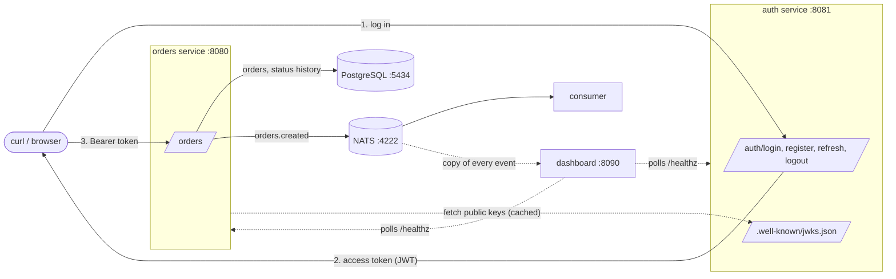

# distributed

A small distributed system in Go, built chapter by chapter while working through a book on distributed systems. It has two HTTP services, a database, a message queue and a consumer, plus a reusable `platform/` SDK that every service builds on.

**Learning notes:** [`docs/notes/`](docs/notes/README.md) has a short page of key points for each chapter.

- **auth** registers users, checks passwords and issues signed JWT access tokens. It publishes its public keys at a JWKS endpoint.
- **orders** creates, lists and updates orders, stored in PostgreSQL. It checks tokens locally, with no call to auth, and announces every new order and status change on NATS.
- **consumer** receives `orders.created` events from NATS and logs them.
- **dashboard** is a status page at http://localhost:8090. It shows each service's health, the NATS server and its clients, and events as they happen.



Everything is the standard library except: `nats.go` (messaging), `golang-jwt/jwt/v5` (tokens), `x/crypto/bcrypt` (password hashing), `pgx/v5` (PostgreSQL) and `golang-migrate` (schema migrations).

---

## Quick start

**You need:** Go 1.27+, Docker (for NATS and PostgreSQL), `openssl` and `curl`.

```sh
make dev     # terminal 1: starts NATS, Postgres, auth, orders, consumer and dashboard
make open    # opens the dashboard at http://localhost:8090
make demo    # terminal 2: walks through the whole API with curl
```

`make dev` does the following:
- Starts NATS in Docker if nothing is listening on :4222, with monitoring on :8222 for the dashboard.
- Starts PostgreSQL 17 in Docker on :5434 if nothing is listening there. Port 5434 avoids clashing with a local Postgres on 5432. The orders service applies its migrations at startup.
- Creates a signing key `key.pem` if it doesn't exist.
- Builds the binaries and runs auth, orders, the consumer and the dashboard, with each log line prefixed by its service name.
- Stops everything on Ctrl-C.

It also creates an admin user, `admin@example.com` / `admin-pass-123`.

`make demo` does the following:
- Registers two users and logs in.
- Shows what's inside a token.
- Creates an order and reads it as its owner, another user and the admin.
- Retries a create with the same `Idempotency-Key` and gets the same order back.
- Lists orders, then shows an optimistic-locking conflict (409) and the status history.
- Refreshes the token, then logs out.

Each step prints the HTTP status, and you can watch the consumer log the event in terminal 1. At the end it prints an `export TOKEN=...` line for your own requests.

Run `make` to list every target.

### Running services one by one

If you'd rather have each service in its own terminal:

```sh
make nats           # NATS in Docker
make postgres       # PostgreSQL in Docker on :5434
make run-auth       # :8081, creates key.pem on first run
make run-orders     # :8080, applies migrations, then serves
make run-consumer
make run-dashboard  # :8090
```

The ports, admin credentials and key file are Make variables, for example `make dev ORDERS_PORT=9090`.

### The dashboard

Open http://localhost:8090 (or run `make open`) while the system is running. The page refreshes every 2 seconds and shows:

- **Topology:** auth and orders, then NATS, then everything subscribed to NATS. A green dot means ready, amber means alive but not ready, red means down.
- **Service cards:** live and ready state, which readiness checks are failing (e.g. `nats`, `auth-keys`), and probe latency.
- **NATS:** version, uptime, message and byte totals, and messages per second.
- **NATS clients:** every connection by name, with its subscriptions, queue group, message counts and round-trip time.
- **Live events:** each `orders.*` event as it's published. New events flash briefly.

Things to try while watching it:
- `make demo`: events appear in the feed.
- Stop orders with Ctrl-C: its tile turns red, and it disappears from the NATS clients.
- Stop NATS: orders turns amber, with `nats` listed as failing. Start NATS again and it recovers on its own.
- `make run-consumers`: two consumers in the `workers` queue group split the events between them (watch "Msgs out"). The dashboard has no queue group, so it receives a copy of every event.

The dashboard reads NATS's built-in monitoring API, which needs `nats-server -m 8222`. `make nats` and `make dev` start NATS that way. If you started NATS yourself without the flag, the NATS tile says so.

---

## Trying it with curl

```sh
# Register
curl -H 'Content-Type: application/json' \
  -d '{"email":"ann@example.com","password":"password123"}' \
  localhost:8081/auth/register

# Log in and keep the access token
TOKEN=$(curl -s -H 'Content-Type: application/json' \
  -d '{"method":"password","credentials":{"email":"ann@example.com","password":"password123"}}' \
  localhost:8081/auth/login | sed 's/.*"access_token":"\([^"]*\)".*/\1/')

# Create an order (the consumer logs an orders.created event)
curl -i -H "Authorization: Bearer $TOKEN" -H 'Content-Type: application/json' \
  -d '{"product_id":"p1","quantity":2}' localhost:8080/orders

# Read it back (use the id from the response or the Location header)
curl -H "Authorization: Bearer $TOKEN" localhost:8080/orders/ord_...

# Look inside the token: the payload is base64, not encrypted
echo "$TOKEN" | cut -d. -f2 | tr '_-' '/+' | base64 -D; echo
```

More requests to try:

```sh
curl localhost:8080/healthz/ready                         # readiness: NATS and signing keys
curl localhost:8081/.well-known/jwks.json                 # public signing keys
curl -i localhost:8080/orders/x                           # 401 MISSING_TOKEN
curl -i -H 'Authorization: Bearer nope' localhost:8080/orders/x     # 401 INVALID_TOKEN
curl -H "Authorization: Bearer $TOKEN" -H 'Content-Type: application/json' \
  -d '{"product_id":"p1","quantity":0}' localhost:8080/orders       # 400 INVALID_FIELD
curl -H "Authorization: Bearer $TOKEN" -H 'Content-Type: text/plain' \
  -d 'hi' localhost:8080/orders                                     # 415
curl -i -H 'X-Request-ID: my-trace-1' localhost:8080/healthz/live   # ID echoed and logged
curl -i -X OPTIONS localhost:8080/orders \
  -H 'Origin: https://app.example' -H 'Access-Control-Request-Method: POST'  # CORS preflight
```

CORS headers appear only for origins listed in `ALLOWED_ORIGINS`, for example `ALLOWED_ORIGINS=https://app.example make run-orders`.

---

## API

All errors use one JSON shape:

```json
{"code": "ORDER_NOT_FOUND", "message": "order not found"}
```

Every response carries an `X-Request-ID` header. If the request sends one, it's reused; otherwise a new one is generated. The same ID appears in every log line for that request.

### Auth service (`:8081`)

All auth routes are public: this is where callers get their tokens.

| Method & path | Body | Success | Errors |
|---|---|---|---|
| `POST /auth/register` | `{"email","password"}` (password: 8-72 bytes) | `201` user | `400 INVALID_FIELD`, `409 EMAIL_TAKEN` |
| `POST /auth/login` | `{"method":"password","credentials":{"email","password"}}` | `200` token pair | `401 INVALID_CREDENTIALS`, `400 UNKNOWN_METHOD` |
| `POST /auth/refresh` | `{"refresh_token"}` | `200` new token pair | `401 INVALID_REFRESH_TOKEN` |
| `POST /auth/logout` | `{"refresh_token"}` | `204` | |
| `GET /.well-known/jwks.json` | | `200` public keys | |
| `GET /healthz/live`, `/healthz/ready` | | `200` | |

Token pair:

```json
{"access_token": "eyJ...", "refresh_token": "QK3...", "token_type": "Bearer", "expires_in": 900}
```

### Orders service (`:8080`)

| Method & path | Needs | Success | Errors |
|---|---|---|---|
| `POST /orders` `{"product_id","quantity"}`, optional `Idempotency-Key` header | `orders:write` | `201` order + `Location`; `200` + `Idempotent-Replayed: true` for a retry with the same key | `400`, `401`, `403 INSUFFICIENT_SCOPE`, `413`, `415`, `422 IDEMPOTENCY_KEY_REUSED` |
| `GET /orders?limit=20&offset=0` | `orders:read` | `200` your orders, newest first (`limit` 1-100) | `400 INVALID_QUERY` |
| `GET /orders/{id}` | `orders:read`; you own it, or you're `admin` | `200` order | `401`, `403`, `404 ORDER_NOT_FOUND` |
| `PATCH /orders/{id}` `{"status","version"}` | `orders:write`; owners may only cancel, admins may make any allowed change | `200` updated order | `403`, `404`, `409 VERSION_CONFLICT`, `422 INVALID_TRANSITION` |
| `GET /orders/{id}/history` | `orders:read` | `200` status changes, oldest first | `404` |
| `GET /healthz/live` | | `200` always, while the process is alive | |
| `GET /healthz/ready` | | `200`, or `503` with the failing checks (`postgres`, `nats`, `auth-keys`) | |

Reading someone else's order returns `404`, not `403`, so the caller can't tell that it exists.

**Order lifecycle:** `pending → paid → shipped`, and `pending` or `paid` can go to `cancelled`. `shipped` and `cancelled` are final. Every change increments `version`. Send back the version you last saw; if someone changed the order since, you get `409` and must re-read it.

### Events (NATS)

```json
// orders.created
{"id": "ord_...", "user_id": "usr_...", "product_id": "p1", "quantity": 2, "created_at": "2026-10-13T10:00:00Z"}
// orders.status_changed
{"id": "ord_...", "user_id": "usr_...", "from": "pending", "to": "paid", "version": 2, "changed_by": "usr_...", "changed_at": "..."}
```

---

## How it works

### Authentication (`platform/auth`)

- **ES256 JWTs.** Auth signs tokens with a private P-256 key. Other services verify them with the public key, which can check signatures but can't create them. Tokens carry `sub` (the user ID), `email`, `role`, `scope`, `iss`, `aud`, `exp` and `jti`.
- **JWKS.** Auth publishes its public keys at `/.well-known/jwks.json`. The orders service fetches them once and caches them:
  - It refetches when a token names an unknown key ID (`kid`), at most once per 30s.
  - It refetches when the cache is 15 minutes old.
  - It retries after 1s if auth was down.

  So rotating keys needs no restarts: publish the new key next to the old one, start signing with the new one, and remove the old one once its tokens have expired.
- **What a token must pass.** Only the ES256 algorithm is accepted; `alg: none` and HS256 with the public key used as the HMAC secret are both rejected. The issuer and audience must match, `exp` is required, clocks may differ by up to 30s, and base64 must be in canonical form.
- **Refresh tokens** are random strings, not JWTs. They're stored only as SHA-256 hashes and work once: each refresh swaps the old one for a new one in a single step, so two simultaneous refreshes with the same token can't both succeed. Logout revokes one. Access tokens live 15 minutes and can't be revoked, which is why they're short-lived.
- **Passwords** are hashed with bcrypt at cost 12, about 300ms per hash. A login with an unknown email still runs a dummy bcrypt check, so response time doesn't reveal which emails are registered.
- **Authorization** is per route: `auth.Authenticate` checks the token, then `auth.RequireScope("orders:read")` or `auth.RequireRole("admin")` checks permissions. Scopes match exactly; `orders:write` doesn't imply `orders:read`.
- **The login hub.** Login sends `{"method": ..., "credentials": ...}` to an `auth.Agent` registered for that method. Adding API keys or OAuth means registering a new agent; the login handler doesn't change.
- **Calling another service as the user.** `auth.ForwardToken(http.DefaultTransport)` copies the caller's token onto outgoing requests.

### HTTP middleware (`platform/middleware`)

Every service uses the same chain. The first layer listed is the outermost:

```
RequestID → Logging → CORS → Recover → Timeout → BodyClose → routes
```

The order matters:
- **RequestID is first**, so every later layer, including Recover's panic log, has the ID.
- **Logging is outside Recover and Timeout**, so it logs the 500 or 504 they write.
- **CORS is outside them too**, so browsers can read those error responses.
- **Timeout** runs the handler in a goroutine that writes into a buffer. A slow handler gets a clean `504` without two goroutines writing to the response at once.

There are also helpers: `WriteJSON`, `WriteError`, `DecodeJSON` (which rejects unknown fields and trailing data, and limits bodies to 1 MB), and liveness and readiness handlers.

### Database (`platform/database`)

- **pgx pool.** `database.NewDB` sets the pool size (default `2 × CPUs`, at least 4), connection lifetimes, and `application_name`, so `SELECT * FROM pg_stat_activity` shows which service holds each connection.
- **`ConnectWithRetry`** retries up to 6 times with exponential backoff and jitter, for when the database starts at the same time as the service. Then it fails with the real error.
- **Migrations** are SQL files compiled into the binary (`internal/orders/migrations/`) and applied with golang-migrate's pgx driver. A PostgreSQL advisory lock means several instances starting together apply each migration once.
  - In development, `DB_MIGRATE=true` migrates at startup.
  - In production, run `orders -migrate` (or `make migrate`) as its own step.
- **Error helpers:** `IsNotFound`, `IsDuplicate`, `IsCheckViolation`, `IsForeignKeyViolation`, `IsRetryable` and `ConstraintName`. The repository turns PostgreSQL errors into domain errors (`ErrNotFound`, `ErrVersionConflict`, ...), so handlers never see pgx.
- **`WithTx`** commits if the function returns nil, and rolls back on an error or a panic.
- **What the orders schema shows:**
  - CHECK constraints are the last line of defence against bad data.
  - Idempotency keys are unique per user, `UNIQUE (user_id, idempotency_key)`.
  - An index on `(user_id, created_at DESC)` matches the list query's filter and sort.
  - A partial index covers only orders still in progress.
  - Status changes are written to `order_status_history` in the same transaction as the update.
- **Optimistic locking:** `UPDATE ... WHERE id = $1 AND version = $3`. Of 20 concurrent updates with the same version, exactly one wins; there's a test for this.

Without `DATABASE_URL`, orders falls back to an in-memory store. A shared set of tests checks that both stores behave the same.

### Messaging (`platform/messaging`)

- Services depend on the `Publisher` and `Subscriber` interfaces, never on NATS directly. NATS, a future Kafka version and test fakes are interchangeable.
- **NATS Core gives at-most-once delivery.** A message published while no consumer is listening is lost. Run `make run-consumers` to see two consumers in one queue group split the events between them.
- The order is saved first and the event published second. If the publish fails, the order still exists and the event is lost; fixing this needs the outbox pattern.

### Concurrency (`platform/concurrency`)

- A worker pool with a fixed number of goroutines. It turns panics into errors and skips queued jobs once its context is cancelled.
- `GracefulShutdown`, which every service uses: it stops taking new requests and lets requests already in progress finish, with a 30s limit.
- `Detach`, for work that must outlive the request (the event publish uses it).

---

## Configuration

All configuration comes from environment variables. The Make targets set them for you.

**auth**

| Variable | Default | |
|---|---|---|
| `PORT` | `8081` | |
| `AUTH_ISSUER` | `http://localhost:8081` | the `iss` claim; must match what orders expects |
| `AUTH_AUDIENCE` | `orders` | comma-separated `aud` claim |
| `AUTH_PRIVATE_KEY_FILE` | *(none)* | P-256 PEM key. If unset, a temporary key is generated and tokens stop working when the process restarts |
| `ACCESS_TOKEN_TTL` | `15m` | |
| `REFRESH_TOKEN_TTL` | `720h` | |
| `ADMIN_EMAIL`, `ADMIN_PASSWORD` | *(none)* | creates an admin user at startup |
| `HTTP_TIMEOUT` | `10s` | per-request deadline |
| `ALLOWED_ORIGINS` | *(none)* | comma-separated CORS origins, `*` for any |

**orders**

| Variable | Default | |
|---|---|---|
| `PORT` | `8080` | |
| `NATS_URL` | `nats://127.0.0.1:4222` | |
| `AUTH_JWKS_URL` | `http://localhost:8081/.well-known/jwks.json` | |
| `AUTH_ISSUER` | `http://localhost:8081` | |
| `DATABASE_URL` | *(none)* | `postgres://...`; without it, orders are kept in memory |
| `DB_MIGRATE` | `false` | `true` applies migrations at startup |
| `DB_MAX_CONNS` | `2 × CPUs` (min 4) | pool size |
| `HTTP_TIMEOUT`, `ALLOWED_ORIGINS` | as for auth | |

`orders -migrate` applies migrations and exits.

**consumer and producer**: `NATS_URL`. The consumer also reads `QUEUE_GROUP`.

**dashboard**: `PORT` (default `8090`), `AUTH_URL` (`http://localhost:8081`), `ORDERS_URL` (`http://localhost:8080`), `NATS_URL`, `NATS_MONITOR_URL` (`http://localhost:8222`).

Both auth and orders start even if NATS or auth is down. The database is different: orders retries for a few seconds, then exits, because it can't do anything without it. `/healthz/ready` returns 503 until their dependencies are reachable, so an orchestrator won't send them traffic too early.

---

## Project layout

```
cmd/
  auth/          auth service
  orders/        orders service
  consumer/      logs orders.created events
  producer/      demo producer from chapter 3 (an event every 2s, no HTTP)
  dashboard/     status page
internal/
  authsvc/       auth service handlers, user and refresh-token store, password agent
  orders/        orders handlers, Postgres and memory stores, routes, migrations/
  dashboard/     health polling, NATS monitoring client, event feed, embedded HTML page
events/          event types and subject names shared by producer and consumers
platform/        the SDK every service uses
  auth/          JWT, JWKS, auth middleware, password hashing, login hub
  middleware/    HTTP middleware chain, JSON errors and decoding, health checks
  messaging/     Publisher and Subscriber interfaces, NATS implementation
  database/      pgx pool, connect with retry, migrations, transactions, error helpers
    dbtest/      a throwaway database per test
  concurrency/   worker pool, graceful shutdown, context helpers
docs/notes/      key points from each chapter
scripts/         dev.sh (run everything), demo.sh (curl walkthrough)
main.go          chapter 2 demo: worker pool and graceful shutdown (make run-pool-demo)
```

## Development

```sh
make test     # all tests with the race detector; database tests are skipped
make test-db  # also the PostgreSQL tests (start it first: make postgres)
make check    # gofmt + go vet + tests: run before committing
make cover    # coverage report in the browser
make psql     # SQL shell on the orders database
```

The tests run against real HTTP servers (`httptest`), real ES256 keys and in-memory stores; `make test` needs no Docker. The database tests (`make test-db`) each create their own throwaway PostgreSQL database, apply the real migrations, and drop it afterwards.

## Chapters

| Chapter | Topic | Where |
|---|---|---|
| 2 | Goroutines, worker pool, graceful shutdown | `platform/concurrency`, `main.go` |
| 3 | Two services, one queue (NATS) | `platform/messaging`, `cmd/producer`, `cmd/consumer` |
| 4 | HTTP services and middleware chains | `platform/middleware`, `internal/orders` |
| 5 | Authentication and JWT across services | `platform/auth`, `internal/authsvc`, `cmd/auth` |
| 6 | Database access and migrations | `platform/database`, `internal/orders` (Postgres store, migrations) |

## Limitations

These are deliberate for now; later chapters address some of them.

- **Auth is still in memory.** Users and refresh tokens disappear when auth restarts; orders are in PostgreSQL.
- **The dev database isn't persistent.** The Docker container runs with `--rm`, so stopping it deletes the data.
- **Pagination uses offset.** Deep pages get slower, and rows can shift between pages; keyset pagination (`WHERE created_at < $cursor`) fixes both.
- **No durable messaging.** NATS Core drops events when no consumer is running.
- **Store, then publish, isn't atomic.** An event can be lost after its order is saved; the outbox pattern fixes this.
- **No service-to-service tokens.** Background jobs would need their own credentials (chapter 9).
- **Login agents run in the same process as auth.** The book adds registration over gRPC in chapter 14.
- **No rate limiting on login,** and NATS has no authentication.
- **Access tokens can't be revoked** before they expire, which takes at most 15 minutes.
